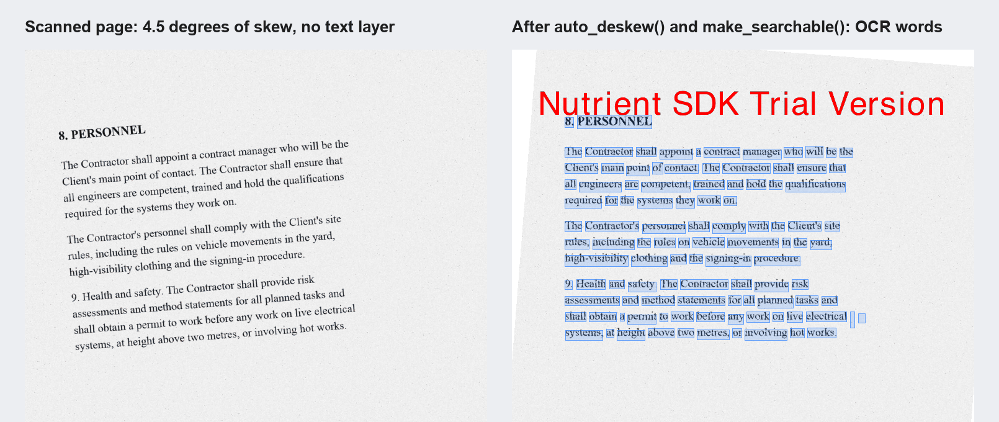

# Nutrient Deskew and OCR (Python)

A Nutrient.io demo that straightens every page of a scanned PDF and makes it searchable with the Nutrient Python SDK, tuned for the time of a single document, with a split mode that spreads one document over several processes or machines, and benchmarks to measure it.



1. **Open.** `Document.open()` loads the scanned PDF. The pages are images without a text layer.
2. **Deskew.** `page.auto_deskew()` measures the skew of each page and rotates the page image back. It returns the angle it applied, 0 when the page is already straight. Pages skewed by more than `skew_tolerance` (15 degrees) are left as they are.
3. **OCR.** `editor.make_searchable()` recognizes the text of the straightened pages and adds an invisible text layer, so the PDF can be searched, selected and indexed.
4. **Save.** `editor.save_as()` writes a new PDF. The original is not modified.

Three OCR settings are tuned for speed:

| Setting | Value | Effect |
|---|---|---|
| `ocr_settings.favor_accuracy` | `False` | Speed mode: one recognition pass, without the inverted-text pass and the layout refiners |
| `ocr_settings.enable_skew_detection` | `False` | The pages are already straight after `auto_deskew()`, so the recognizer does not measure the skew again |
| `ocr_settings.max_threads` | `NUTRIENT_OCR_THREADS`, default `0` | Pages OCR'd in parallel inside `make_searchable()`. `0` = one thread per CPU core |

## What sets the time of one document

- **The CPU time per page is fixed.** It depends on the page size, resolution and amount of text, not on the code around it. `enable_preprocessing`, `enable_table_detection` and the render DPI did not change the time of `make_searchable()` in our tests. `favor_accuracy = False` saves about 8% of CPU time.
- **So the time of one document goes down with the number of cores working on it.** `max_threads` does that inside `editor.make_searchable()`. The SDK default is `1`, so one core.
- **Call the document-level `editor.make_searchable()`.** `page.make_searchable()` called page by page runs on one core whatever `max_threads` says.
- **Check the cores you really get.** `latency.py` prints "cores used" (CPU time / wall time). In a container limited to 2 CPUs, any `max_threads` above 2 gives the same time as 2.
- **Split mode** (`NUTRIENT_OCR_WORKERS`) cuts the document into page ranges, deskews and OCRs each range in its own process, and merges the parts in page order with `editor.append_document()`. The deskew step runs in parallel too. The same split and merge can run across serverless invocations, which is the way to cut the time of one long document when each invocation only has one or two vCPUs.
- **Set the languages explicitly.** `make_searchable()` reads the default `"auto"` as English. Use `NUTRIENT_OCR_LANGUAGES`, for example `dan` or `dan+eng`.

The old and new versions are compared on the same files and machines in [docs/benchmark-old-vs-new.md](docs/benchmark-old-vs-new.md).

## Nutrient technology used

| Product | Version | Role in this PoC |
|---|---|---|
| Nutrient Python SDK | 1.0.13 | Deskew (`PdfPage.auto_deskew`), OCR to searchable PDF (`PdfEditor.make_searchable`, `OcrSettings.max_threads`), page split and merge (`PdfPageCollection.remove_at`, `PdfEditor.append_document`) |

## Prerequisites

- Python 3.12 or later
- macOS on Apple Silicon, Linux x86_64 or Linux ARM64 with glibc 2.36 or later (the Nutrient Python SDK native runtimes are `manylinux_2_36` wheels)
- On Linux, the ICU library: `libicu76` on Debian 13. Without it the SDK stops at start-up with "Couldn't find a valid ICU package"

## Environment variables

Copy `.env.example` to `.env` and load it in your shell, or export the variables. The license key is only read from the environment, never from code.

| Variable | Purpose | Default |
|---|---|---|
| `NUTRIENT_LICENSE_KEY` | Nutrient Python SDK license key | empty = evaluation mode |
| `NUTRIENT_OCR_THREADS` | Pages OCR'd in parallel by `make_searchable()`. `0` = one thread per CPU core | `0` |
| `NUTRIENT_OCR_WORKERS` | Worker processes for one document (split mode). `1` = no split | `1` |
| `NUTRIENT_OCR_LANGUAGES` | OCR languages, combined with `+`, for example `dan+eng` | `eng` |

In evaluation mode the SDK adds a "Nutrient SDK Trial Version" mark to every output page, and each process can run for one hour. Deskew and OCR work fully.

## Build and run

```bash
python3 -m venv .venv
```

```bash
source .venv/bin/activate
```

```bash
pip install -r requirements.txt
```

```bash
cp .env.example .env
```

```bash
set -a; . ./.env; set +a
```

```bash
python deskew_ocr.py
```

The script reads `samples/skewed-scan.pdf` and writes `outputs/skewed-scan-deskewed-ocr.pdf`. To process your own file, pass its path, and optionally the output path:

```bash
python deskew_ocr.py path/to/scan.pdf path/to/result.pdf
```

Split mode, four worker processes:

```bash
NUTRIENT_OCR_WORKERS=4 python deskew_ocr.py path/to/scan.pdf
```

### Docker

The `Dockerfile` builds a Linux image with the SDK and the ICU library. It also runs the sample once at build time, so the OCR models are downloaded into the image: otherwise every fresh container, or serverless cold start, downloads them before its first document. In a container limited to 2 CPUs, the 6-page sample took 7.1 s on 1.0 core without that step and 3.9 s on 1.9 cores with it. Pass the languages you use: their models are downloaded at build time and the value becomes the image's default `NUTRIENT_OCR_LANGUAGES`:

```bash
docker build -t deskew-ocr --build-arg NUTRIENT_OCR_LANGUAGES=dan+eng .
```

Limit the CPUs to match your production container:

```bash
docker run --rm --cpus=2 deskew-ocr latency.py --config 1x1 --config 1x2 --config 2x1
```

## Usage

`deskew_ocr.py` prints the angle applied to each page, the time of each step and the CPU cores used. On the sample:

```text
Page 1: corrected 3.25 degrees of skew.
Page 2: corrected -1.75 degrees of skew.
Page 3: no skew detected, left unchanged.
Page 4: corrected -4.50 degrees of skew.
Page 5: corrected 1.44 degrees of skew.
Page 6: corrected -2.56 degrees of skew.

Pages         : 6 (5 deskewed)
Deskew        : 0.19 s
OCR           : 1.32 s (one thread per core)
Total time    : 1.59 s
Time per page : 0.27 s
CPU cores used: 4.10 on average
```

The angles match the skew the sample generator applied (`samples/skew-angles.json`), with the opposite sign, within 0.05 degrees. The OCR engine may print `Error in pixGetInvBackgroundMap` lines for very small image regions; they do not affect the result.

### Latency of one document

`latency.py` deskews and OCRs one document with several ways of spreading it over the cores. Each configuration is `WORKERSxTHREADS`: `1x1` is one process with one OCR thread, `1x0` one process with one thread per core, `4x3` four worker processes with three threads each.

```bash
python samples/generate_scans.py --pages 68
```

```bash
python latency.py samples/skewed-scan-68p.pdf --config 1x1 --config 1x2 --config 1x4 --config 1x0 --config 4x3
```

On an Apple M2 Pro laptop (12 cores), evaluation mode:

```text
skewed-scan-68p.pdf | languages eng | 1 run(s) per config | Darwin arm64, 12 CPUs visible
 config  median s   min s   max s  s/page  cores used
    1x1      59.5    59.5    59.5    0.88        1.08
    1x2      30.9    30.9    30.9    0.46        2.08
    1x4      17.5    17.5    17.5    0.26        3.74
    1x0      14.6    14.6    14.6    0.21        4.83
    4x3      10.0    10.0    10.0    0.15        7.18
```

The time of `1x1` is the SDK default. `1x0` uses every core inside one `make_searchable()` call. Split mode (`4x3`) also runs the deskew step in parallel. In a container limited to 2 CPUs, more than 2 OCR threads do not help: more vCPUs, or more invocations in split mode, do.

### Batch throughput

`benchmark.py` processes the same PDF many times across worker processes and reports the throughput and the time per document and per page:

```bash
python benchmark.py 100 4
```

The arguments are the number of runs (default 100), the number of worker processes (default: CPU cores divided by `NUTRIENT_OCR_THREADS`, which is 2 here unless set to a positive value) and an optional input PDF. Keep workers x `NUTRIENT_OCR_THREADS` at or below the number of CPU cores: oversubscription lowers the total throughput.

The numbers depend on the CPU, the page size and resolution, and the amount of text per page. Run the benchmarks on your own scans.
